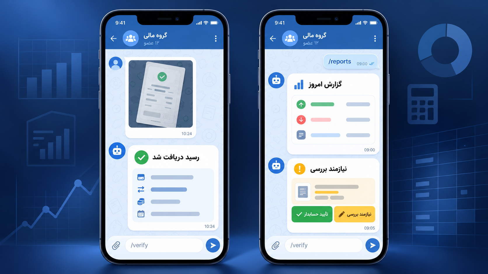
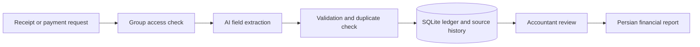

# Telegram Receipt & Financial Reconciliation Bot

This project helps Persian-speaking Telegram groups keep track of payment requests, receipt images, receipt text, and accounting reviews. Group members submit evidence in Telegram; managers and accountants review it and receive Persian reports without using a separate dashboard.

A receipt is treated as evidence, not proof that money reached a bank account. Requested amounts, submitted receipts, confirmed settlements, payment promises, and unresolved differences remain separate throughout the system.

[راهنمای فارسی مشتری (PDF)](docs/client-user-guide.fa.pdf)



<sub>The preview uses synthetic data. It is not a customer conversation or a production screenshot.</sub>

## How it works



Gemini or OpenRouter turns Persian receipt images and text into candidate fields. Python then validates those fields, prevents duplicate counting, records the source message, and calculates reports only from stored accounting records and reviewer decisions.

## Telegram workflow

An allowlisted Telegram username can activate a group with `/start` only while that account is a current administrator of the group. After activation, group members may submit financial messages and receipts. Reporting, verification, settings, and cleanup remain restricted to group administrators or authorized accounting reviewers.

The bot accepts JPEG, PNG, and WebP receipt images as well as receipt text. It normalizes Persian and English digits, keeps rial and toman distinct, and marks unreadable or ambiguous fields for review.

| Command | What it does | Who can use it |
|---|---|---|
| `/start` | Activates an approved group or completes a private handoff | Allowlisted current group administrator |
| `/help` | Shows the Persian command guide | Members of an approved group |
| `/request` | Records a payment request by replying to a person's message | Administrator or accounting reviewer |
| `/promise` | Records a payment promise without counting it as payment | Administrator or accounting reviewer |
| `/reports` | Shows today's report and date-range controls | Administrator or accounting reviewer |
| `/summary` | Separates requested, submitted, confirmed, promised, and unresolved totals | Administrator or accounting reviewer |
| `/receipts` | Browses receipt evidence and processing status | Administrator or accounting reviewer |
| `/pending` | Lists items that need human review | Administrator or accounting reviewer |
| `/verify` | Confirms, corrects, rejects, links, splits, or marks evidence as duplicate | Authorized reviewer |
| `/transactions` | Browses requests, receipts, payments, allocations, and promises | Administrator or accounting reviewer |
| `/balance` | Shows one person's documented position, with uncertain amounts separated | Administrator or accounting reviewer |
| `/settings` | Manages reviewers and receipt-image retention | Current group administrator |
| `/cleanup` | Previews and confirms deletion of eligible old image files | Current group administrator |

Inline buttons handle dates, pagination, record selection, correction, and confirmation. Where private handoff is available, sensitive details can be opened in a direct conversation instead of the public group.

The `پشتیبانی ربات` button opens [@amixrmz](https://t.me/amixrmz), the support contact and developer. It is also available on access-denied screens.

## Financial rules

All totals are calculated with integer rial values in Python; the AI provider does not calculate balances or report totals.

- Rial, toman, and unknown currency units are stored as different states.
- A payment promise is not counted as a receipt or a completed payment.
- A receipt is not counted twice when the same Telegram message, file, or file content is submitted again.
- The system does not invent a match between a receipt and a payment request.
- A difference on one request is not presented as a person's total debt.
- Corrections add a new revision and audit event instead of erasing the original extraction.
- Each report keeps the source records and Telegram message references behind its values.
- Every database query and update is scoped to one Telegram group.

The `/cleanup` command removes only eligible image files inside the managed receipt directory. It requires an administrator preview and confirmation; extracted fields, transactions, associations, reports, and audit history stay in the database.

## Run locally

The supported Python versions are 3.12 and 3.13. On Windows PowerShell:

```powershell
git clone https://github.com/dariushmmz/telegram-financial-agent.git
Set-Location telegram-financial-agent

python -m venv .venv
.\.venv\Scripts\Activate.ps1
python -m pip install --upgrade pip
python -m pip install -r requirements-test.lock
Copy-Item .env.example .env
```

Edit `.env` and provide your own credentials:

```dotenv
TELEGRAM_BOT_TOKEN=replace-with-your-telegram-token
RECEIPT_BOT_TELEGRAM_BOT_USERNAME=replace_with_your_bot_username
RECEIPT_BOT_ALLOWED_TELEGRAM_USERNAMES=@trusted_admin
RECEIPT_BOT_EXTRACTION_PROVIDER=gemini
GEMINI_API_KEY=replace-with-your-google-ai-studio-key
```

The username allowlist is comma-separated and case-insensitive. A leading `@` is optional. Configuration fails closed when the list is missing, empty, malformed, or contains duplicates.

For OpenRouter, set `RECEIPT_BOT_EXTRACTION_PROVIDER=openrouter` and provide `OPENROUTER_API_KEY`. Do not place real credentials in source files, screenshots, command arguments, or Git history.

Prepare the SQLite database and start long polling:

```powershell
python scripts/manage_runtime.py prepare
python scripts/run_bot.py
```

`prepare` creates managed storage directories, runs the Alembic database migrations, and checks the database and receipt-storage paths. Add the bot to the intended Telegram group, make the allowlisted account a group administrator, and send `/start` from that account.

If the machine requires the local SOCKS proxy used during development:

```powershell
$env:HTTP_PROXY  = 'socks5h://127.0.0.1:10808'
$env:HTTPS_PROXY = 'socks5h://127.0.0.1:10808'
$env:ALL_PROXY   = 'socks5h://127.0.0.1:10808'
```

## Storage

The application uses SQLite, a database stored in one local file. The default path is `data/receipt_bot.db`; receipt image files are kept separately under `data/receipts/`.

The database stores Telegram source references, groups and users, role assignments, requests, image and text evidence, immutable extraction attempts, payments, allocations, reviews, corrections, audit events, report runs, and temporary interaction sessions.

For read-only inspection in SQLite Expert or `sqlite3`:

```sql
PRAGMA integrity_check;
PRAGMA foreign_key_check;

SELECT id, telegram_chat_id, title, active
FROM telegram_groups
ORDER BY id;

SELECT pe.id, pe.group_id, pe.evidence_kind, pe.classification_state,
       p.evidence_state, p.amount_rial, p.amount_unit,
       pe.source_message_id, pe.created_at
FROM payment_evidence AS pe
LEFT JOIN payments AS p
  ON p.evidence_id = pe.id AND p.group_id = pe.group_id
ORDER BY pe.id DESC
LIMIT 50;
```

Stop the bot or open the database in read-only mode before inspecting it. Accounting changes should go through `/verify` so the audit history is retained.

## Run with Docker

```powershell
Copy-Item .env.example .env
New-Item -ItemType Directory -Path backups -Force | Out-Null
docker compose up --build -d
docker compose ps
docker compose logs --tail 100 receipt-bot
```

The Compose configuration runs one non-root bot process. Its named volume contains the SQLite database and managed receipt images; `./backups` is mounted separately.

```powershell
docker compose exec receipt-bot python scripts/manage_runtime.py check
docker compose exec receipt-bot python scripts/manage_runtime.py backup /app/backups/receipt-bot.db
docker compose stop
```

Run one replica only. Multiple bot processes and SQLite on shared network storage are not supported by this MVP.

## Development and tests

```powershell
$env:PYTEST_DISABLE_PLUGIN_AUTOLOAD = '1'
python -m pytest
python -m compileall -q src scripts tests
python scripts/security_scan.py
docker build --tag telegram-receipt-bot:local .
```

Tests use mocked Telegram and AI responses and do not spend provider credit. Live provider checks are opt-in because they send data outside the machine; use only synthetic or explicitly authorized receipts.

The code is split by responsibility:

| Package | Responsibility |
|---|---|
| `telegram` | Telegram API calls, polling, commands, callbacks, and authorization |
| `extraction` | Provider adapters, image checks, structured extraction, and validation |
| `reconciliation` | Matching, allocation, reviews, corrections, and audit events |
| `reporting` | Deterministic calculations and Persian report rendering |
| `persistence` | SQLAlchemy models, repositories, and SQLite transactions |
| `cleanup` | Safe receipt-image retention and deletion |

Database schema changes are versioned under `migrations/`. Runtime and maintenance entry points live under `scripts/`, and deterministic tests are under `tests/`.

See [CONTRIBUTING.md](CONTRIBUTING.md) before changing code or test data.

## Current limits

- The bot does not query a bank or independently confirm settlement.
- Handwriting extraction is uncertain and always requires human review when fields are unclear.
- Messages sent before the bot joined and activated in a group are not imported.
- OpenRouter live transport still requires a valid key and a separate live check.
- WhatsApp, custom OCR training, external accounting software, horizontal scaling, and a web dashboard are outside this MVP.
- Hosting and AI API usage are operating costs separate from development.
- Production sign-off still requires a real Telegram staging run, restart recovery check, and backup-restore rehearsal.

The current deliverable is not presented as an already-running production service.

## Client guide and support

- [راهنمای فارسی مشتری (PDF)](docs/client-user-guide.fa.pdf)
- [Telegram support: @amixrmz](https://t.me/amixrmz)

## License

No open-source license has been selected. Copyright remains with the project owner; do not redistribute the code without permission.
