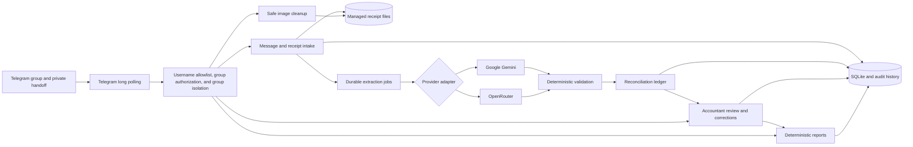
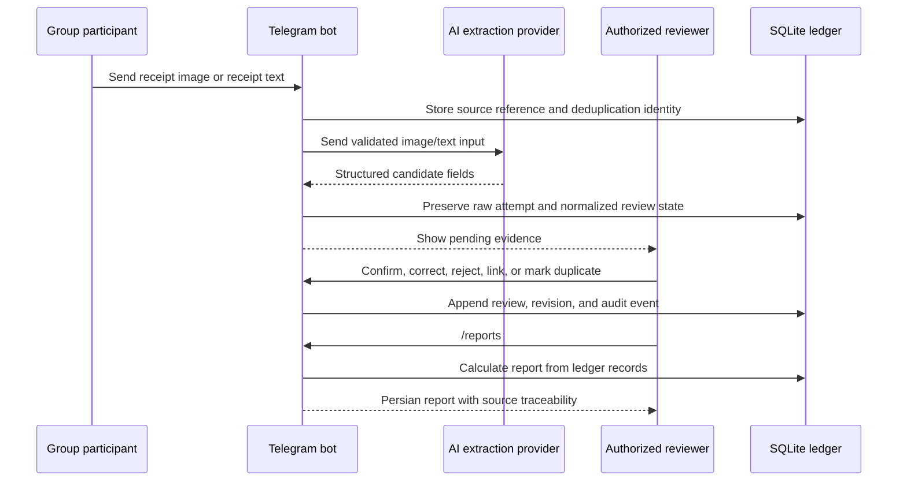

# Telegram Receipt & Financial Reconciliation Bot

An AI-assisted Telegram bot for collecting Persian payment requests and receipt evidence, reviewing uncertain records, reconciling payments, and producing traceable accounting reports—without a separate web dashboard.

> [!IMPORTANT]
> A submitted receipt is evidence, not independent proof of bank settlement. The system keeps requested, submitted, confirmed, promised, and unresolved amounts separate and never turns an uncertain difference into a person's final debt.


<sub>This is a fully synthetic product mockup, not a real customer conversation or live-test screenshot. It contains no real financial data.</sub>

## What the system does

For a group administrator or accountant, the workflow is simple:

1. An environment-allowlisted Telegram username whose account is also a current group administrator activates the group with `/start`.
2. A participant sends a bank screenshot, photographed receipt, handwritten form, or receipt text to that authorized Telegram group.
3. The bot preserves the source message and sender, then extracts Persian financial fields with Gemini or an OpenRouter-compatible model.
4. Deterministic Python validation normalizes Persian/English digits, checks identifiers and currency units, detects exact duplicates, and flags uncertainty.
5. An authorized reviewer confirms, corrects, rejects, links, or marks the evidence as duplicate through inline buttons.
6. `/reports` produces per-request and group totals while preserving a trace from every reported amount back to its source record.
7. `/cleanup` can remove old image files after an administrator preview and confirmation; accounting records and audit history remain intact.

The bot is designed for Persian-speaking financial groups and renders readable toman amounts while storing exact money values as integer rial.

## Architecture

The MVP is one lightweight Python service with explicit internal boundaries:





### Main components

| Area | Responsibility |
|---|---|
| `telegram` | Long polling, commands, callback sessions, private handoffs, and server-side authorization |
| `extraction` | Provider-neutral schema, Gemini/OpenRouter adapters, image preprocessing, text parsing, validation, and uncertainty |
| `reconciliation` | Conservative matching, duplicate handling, allocations, reviews, corrections, and audit events |
| `reporting` | Deterministic per-request and group calculations with Persian rendering and source manifests |
| `persistence` | SQLAlchemy models, repositories, group isolation, and SQLite transactions |
| `cleanup` | Previewed, admin-only deletion inside the managed receipt directory |
| `operations` | Migrations, health checks, online backup, safe restore, and startup recovery |

## Telegram commands

Commands operate on the current group by default. Financial data is scoped by Telegram group ID, and sensitive actions are authorized again on the server even if a button is visible.

| Command | Purpose | Access |
|---|---|---|
| `/start` | Activate the bot for a group or complete a private handoff | Allowlisted username belonging to a current group administrator |
| `/help` | Show the Persian command guide | Group members |
| `/reports` | Today's accounting report, with inline date/range navigation | Administrators and authorized accountants |
| `/summary` | Requested, submitted, confirmed, promised, and unresolved totals | Administrators and authorized accountants |
| `/receipts` | Browse receipt evidence, extracted fields, and processing state | Administrators and authorized accountants |
| `/pending` | List records that require human review | Administrators and authorized accountants |
| `/verify` | Confirm, correct, reject, link, split, or mark selected evidence as duplicate | Authorized reviewers |
| `/transactions` | Browse requests, receipts, payments, allocations, and promises | Administrators and authorized accountants |
| `/balance` | Show one person's documented position, separating confirmed and uncertain amounts | Administrators and authorized accountants |
| `/request` | Reply to a participant's original message to create a traceable payment request | Administrators and authorized accountants |
| `/promise` | Reply to a participant's original message to record a promise—not a payment | Administrators and authorized accountants |
| `/settings` | Configure retention and accounting reviewers | Current group administrator |
| `/cleanup` | Preview and confirm age-based receipt-image deletion | Current group administrator |

Inline keyboards handle date selection, pagination, person/receipt selection, confirmation, correction, and navigation. Detail views can continue in a short-lived private session to keep sensitive fields out of the public group.

The `پشتیبانی ربات` button appears in the start/main, help, settings, and access-denied views. It opens [@amixrmz](https://t.me/amixrmz), the bot's support contact and developer, and remains available to users who do not yet have access.

### Example report contract

```text
گزارش حساب‌های امروز — مبالغ به تومان

۱. کاربر نمونه: درخواست ۶۰۰٬۰۰۰٬۰۰۰؛ مبلغ فیش ۶۰۰٬۰۰۰٬۰۰۰؛
   اختلاف صفر؛ وضعیت حسابداری: تکمیل.

۲. کاربر آزمایشی: درخواست ۱٬۱۰۰٬۰۰۰٬۰۰۰؛ مبلغ فیش ۱٬۰۹۳٬۹۰۰٬۰۰۰؛
   اختلاف ۶٬۱۰۰٬۰۰۰؛ وضعیت: نیازمند بررسی.

جمع درخواست‌ها: ۱٬۷۰۰٬۰۰۰٬۰۰۰
جمع مبالغ فیش‌ها: ۱٬۶۹۳٬۹۰۰٬۰۰۰
اختلاف قابل بررسی: ۶٬۱۰۰٬۰۰۰

مبالغ فیش‌ها به معنی تأیید مستقل وصول بانکی نیستند.
اختلاف‌ها نیز تا زمان بررسی حسابداری بدهی قطعی محسوب نمی‌شوند.
```

## Financial correctness and safety

- All calculations use deterministic integer arithmetic; AI never calculates report totals.
- Rial and toman are distinct units. Unknown or ambiguous units stay unresolved for review.
- Requests, receipt evidence, externally confirmed settlement, and payment promises are different records.
- A receipt is counted once through Telegram update/message/file/hash idempotency and database constraints.
- Matching is conservative. Ambiguous associations are surfaced instead of invented.
- A request-level difference is not presented as a person's overall debt.
- Reviewer corrections append immutable revisions and audit events; the original extraction remains available.
- Every report stores a source manifest and the Telegram message references behind its values.
- Every query and mutation is group-scoped to prevent cross-group data leakage.

## Technology choices

- Python 3.12 or 3.13
- SQLAlchemy 2 and Alembic migrations
- SQLite in WAL mode for a single-process MVP
- Pydantic settings and structured extraction schemas
- Google Gemini through the official `google-genai` SDK
- OpenRouter-compatible HTTP adapter using `httpx`
- Telegram Bot API long polling without an additional bot framework
- Pillow for bounded, validated JPEG/PNG/WebP preprocessing
- Pytest with mocked provider and Telegram responses
- Docker/Compose for a non-root, single-replica deployment

## Repository layout

```text
.
├── .github/workflows/ci.yml    # tests, security scan, and container build
├── docs/                       # roadmap, milestone evidence, runbooks, assets
├── migrations/                 # ordered Alembic database migrations
├── scripts/                    # runtime, operations, smoke-test, and compatibility CLIs
├── src/receipt_bot/
│   ├── cleanup/                # safe receipt-image retention
│   ├── domain/                 # money, time, enums, and text evidence
│   ├── extraction/             # provider-neutral extraction pipeline
│   ├── persistence/            # database models and repositories
│   ├── reconciliation/         # matching and accounting state transitions
│   ├── reporting/              # deterministic report engine and renderer
│   └── telegram/               # API, polling, handlers, and workflows
├── tests/                      # deterministic unit/integration tests and synthetic fixtures
├── tools/                      # optional owner utilities, separate from the runtime
├── .env.example                # configuration names only; never real secrets
├── compose.yaml
├── Dockerfile
├── pyproject.toml
└── requirements*.lock
```

Local `data/`, `backups/`, `debug/`, and `samples/` directories are intentionally ignored by Git. Treat every receipt—even a development fixture—as sensitive unless it is demonstrably synthetic.

## Quick start on Windows PowerShell

### 1. Create the environment

```powershell
python --version  # supported: 3.12 or 3.13
python -m venv .venv
.\.venv\Scripts\Activate.ps1
python -m pip install --upgrade pip
python -m pip install -r requirements-test.lock
```

### 2. Configure credentials

```powershell
Copy-Item .env.example .env
```

Edit `.env` and set at least:

```dotenv
TELEGRAM_BOT_TOKEN=replace-with-a-new-bot-token
RECEIPT_BOT_ALLOWED_TELEGRAM_USERNAMES=@amixrmz
RECEIPT_BOT_EXTRACTION_PROVIDER=gemini
GEMINI_API_KEY=replace-with-a-google-ai-studio-key
```

Use one or more trusted Telegram usernames separated by commas. A leading `@` is optional and matching is case-insensitive, so `@AmixRmz` is normalized to `amixrmz`. Only an allowlisted username whose account Telegram currently reports as a group administrator can activate that group. A missing, empty, malformed, or duplicate allowlist prevents startup.

Telegram usernames can be changed and may later be reassigned, so they are weaker authorization identifiers than numeric Telegram User IDs. The bot stores the activating account's numeric ID for audit traceability, but the configured username remains the group-authorization anchor. If an administrator changes username, update the environment, restart, and run `/start` again in each approved group.

Use `OPENROUTER_API_KEY` and set `RECEIPT_BOT_EXTRACTION_PROVIDER=openrouter` only when choosing that provider. Never paste secrets into source files, command arguments, screenshots, issue reports, or Git history.

If this machine needs the local SOCKS proxy:

```powershell
$env:HTTP_PROXY  = 'socks5h://127.0.0.1:10808'
$env:HTTPS_PROXY = 'socks5h://127.0.0.1:10808'
$env:ALL_PROXY   = 'socks5h://127.0.0.1:10808'
```

### 3. Prepare and run

```powershell
python scripts/manage_runtime.py prepare
python scripts/run_bot.py
```

`prepare` creates the managed storage directories, upgrades the SQLite schema to the current Alembic revision, and verifies database integrity, foreign keys, schema revision, and storage access. The bot then runs as one long-polling process.

Before a real group test, configure BotFather privacy mode and group permissions using the [operations runbook](docs/OPERATIONS.md#2-telegram-and-botfather-setup).

## Docker Compose deployment

```powershell
Copy-Item .env.example .env
New-Item -ItemType Directory -Path backups -Force | Out-Null
# Securely fill .env, then:
docker compose up --build -d
docker compose ps
docker compose logs --tail 100 receipt-bot
```

The `receipt-data` volume holds `/app/data/receipt_bot.db` and managed receipt images. `./backups` is mounted separately. Run exactly one replica: multiple bot processes and shared/network SQLite storage are outside the supported MVP topology.

Useful operations:

```powershell
docker compose exec receipt-bot python scripts/manage_runtime.py check
docker compose exec receipt-bot python scripts/manage_runtime.py backup /app/backups/receipt-bot.db
docker compose stop
```

See [docs/OPERATIONS.md](docs/OPERATIONS.md) for Linux deployment, upgrades, backup/restore rehearsal, health checks, retention, monitoring, and incident response.

## Database and stored data

The local database is SQLite at `data/receipt_bot.db` by default. It stores Telegram source references, users/groups and roles, requests, image/text evidence, immutable extraction attempts, payments and allocations, reviews, corrections, audit events, report runs, and short-lived interaction sessions. Receipt image bytes live separately under `data/receipts/`.

Read-only inspection examples for SQLite Expert or `sqlite3`:

```sql
PRAGMA integrity_check;
PRAGMA foreign_key_check;

SELECT id, telegram_chat_id, title, active
FROM telegram_groups
ORDER BY id;

SELECT pe.id, pe.group_id, pe.evidence_kind, pe.classification_state,
       p.evidence_state, p.amount_rial, p.amount_unit,
       pe.source_message_id, pe.created_at
FROM payment_evidence AS pe
LEFT JOIN payments AS p
  ON p.evidence_id = pe.id AND p.group_id = pe.group_id
ORDER BY pe.id DESC
LIMIT 50;

SELECT id, group_id, decision, reviewer_user_id, comment, created_at
FROM reviews
ORDER BY id DESC
LIMIT 50;

SELECT id, group_id, action, actor_user_id, created_at
FROM audit_events
ORDER BY id DESC
LIMIT 100;
```

Stop the bot or use a read-only connection for manual inspection. Do not edit production rows with a database browser; accounting corrections belong in `/verify` so their audit history is preserved.

## Development and validation

```powershell
$env:PYTEST_DISABLE_PLUGIN_AUTOLOAD = '1'
python -m pytest -q
python -m compileall -q src scripts tests
python scripts/security_scan.py
docker build --tag telegram-receipt-bot:local .
```

Live provider calls are intentionally excluded from the automated suite because they spend credit and disclose receipt content to an external service. Use only synthetic or explicitly authorized media and follow [docs/LIVE_EXTRACTION_TESTS.md](docs/LIVE_EXTRACTION_TESTS.md). The provider-neutral compatibility CLI is available as:

```powershell
python scripts/extract_receipt.py --help
```

Contribution and synthetic-fixture rules are in [CONTRIBUTING.md](CONTRIBUTING.md). CI repeats compilation, the deterministic test suite, the secret scan, and a production container build without using credentials.

## Deployment status and known limits

All seven planned engineering milestones are implemented and covered by deterministic tests. Production acceptance remains conditional on the isolated real-Telegram checklist and human accounting review.

- Existing databases created before the username-allowlist hardening require each intended group to be reactivated with `/start` by an allowlisted current administrator. No financial records are removed.
- Rotate the development Telegram and Gemini credentials before any further staging; they were exposed by an earlier local Compose diagnostic.
- Direct Gemini transport and structured response were smoke-tested with an authorized fixture; OpenRouter live transport remains pending until a key is available.
- Handwriting extraction can be uncertain and is never guaranteed to be 100% accurate.
- The bot does not independently query a bank or prove settlement.
- Pre-bot Telegram history cannot be recovered automatically.
- Horizontal scaling, WhatsApp, custom OCR training, external accounting systems, and a web dashboard are outside this MVP.
- Provider usage and hosting are separate operating costs.

Use [docs/STAGING_ACCEPTANCE.md](docs/STAGING_ACCEPTANCE.md) before production sign-off. The authoritative implementation history is [docs/PROJECT_PLAN.md](docs/PROJECT_PLAN.md), with a report for each completed step under `docs/STEP_00_REPORT.md` through `docs/STEP_07_REPORT.md`.

## Documentation map

| Document | Audience and purpose |
|---|---|
| [Persian client user guide](docs/client-user-guide.fa.md) ([PDF](docs/client-user-guide.fa.pdf)) | Short, non-technical instructions for customers, including the separate Hamravesh deployment phase |
| [Project plan](docs/PROJECT_PLAN.md) | Architecture, data model, seven-day milestones, acceptance criteria, and implementation status |
| [Operations runbook](docs/OPERATIONS.md) | Deployment, BotFather configuration, health, backup/restore, retention, and incident handling |
| [Staging acceptance](docs/STAGING_ACCEPTANCE.md) | Evidence-based real-Telegram test checklist |
| [Live extraction tests](docs/LIVE_EXTRACTION_TESTS.md) | Safe opt-in Gemini/OpenRouter smoke-test procedure |
| [Step 07 report](docs/STEP_07_REPORT.md) | Final engineering evidence, limitations, and production-signoff gaps |
| [Access allowlist report](docs/ACCESS_ALLOWLIST_REPORT.md) | Post-MVP access hardening, support UI, tests, and rollout notes |

## License

No open-source license has been selected. Copyright remains with the project owner; do not redistribute the code without permission.
